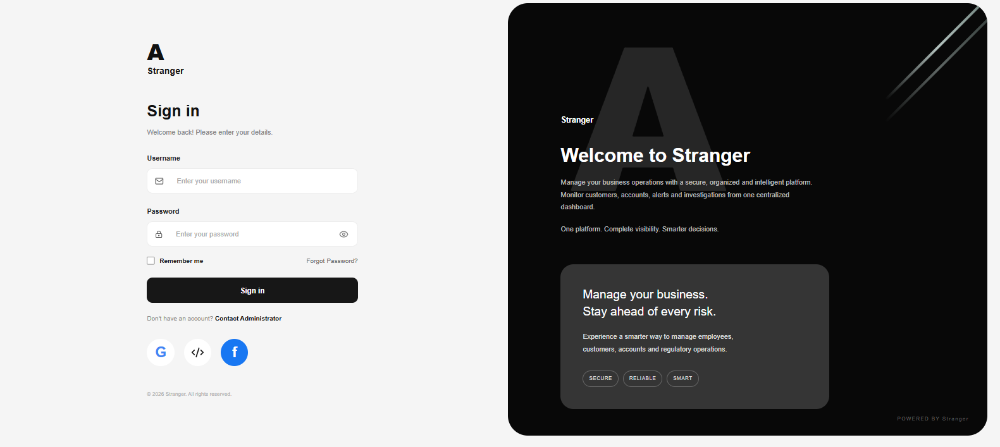

# FTS

FTS is an enterprise-level financial monitoring and compliance management platform designed to help financial institutions monitor transactions, identify suspicious activities, manage risk alerts, and conduct investigations. It provides centralized management of customers, accounts, transactions, alerts, and investigations, along with secure user access through role-based permissions, multi-factor authentication (MFA), and maker-checker approval workflows.

The platform is intended for banks, financial institutions, compliance teams, risk management departments, fraud investigators, and financial administrators who need a secure, centralized solution for financial surveillance, operational control, and regulatory compliance.


## Tech Stack

**Client:** React, TypeScript, Vite, React Router DOM,

**Server:** Java 17, Spring Boot, Maven

**Database:** MySQL


## Screenshots

### Login Page



## Installation

Follow these steps to set up the FTS project locally.

### 1. Clone the Repository

```bash
git clone https://github.com/NeerajPatidar09/FTS.git
cd FTS
```

### 2. Backend Setup (Spring Boot)

Make sure Java 17 and Maven are installed.

```bash
cd server
```

Configure your database and environment variables, then run:

```bash
mvn clean install
mvn spring-boot:run
```

The backend will run at:

```text
http://localhost:8080
```

### 3. Frontend Setup (React + TypeScript)

Make sure Node.js and npm are installed.

```bash
cd client
npm install
```

Start the development server:

```bash
npm run dev
```

The frontend will run at the URL displayed in your terminal (typically `http://localhost:5173`).

### 4. Verify Installation

- Confirm that the MySQL database is running.
- Confirm that the Spring Boot backend starts successfully.
- Open the frontend development URL in your browser.
- Sign in using your configured application credentials.
## Environment Variables

To run this project locally, configure the following environment variables in your `.env` file or provide them through your deployment environment.

### Backend Configuration

| Variable | Description |
|---|---|
| `DB_URL` | MySQL database connection URL |
| `DB_USERNAME` | MySQL database username |
| `DB_PASSWORD` | MySQL database password |
| `JWT_SECRET` | Secret key used for JWT signing |
| `JWT_ACCESS_EXPIRATION` | Access token expiration time |
| `JWT_REFRESH_EXPIRATION` | Refresh token expiration time |
| `MFA_ENCRYPTION_KEY` | Base64-encoded AES-256 encryption key for MFA secrets |
| `MAIL_HOST` | SMTP server hostname |
| `MAIL_PORT` | SMTP server port |
| `MAIL_USERNAME` | SMTP username |
| `MAIL_PASSWORD` | SMTP password |
| `APP_FRONTEND_URL` | Frontend application URL |

### Example `.env` file

```env
DB_URL=jdbc:mysql://localhost:3306/fts_db
DB_USERNAME=root
DB_PASSWORD=your_database_password

JWT_SECRET=your_secure_jwt_secret
JWT_ACCESS_EXPIRATION=900000
JWT_REFRESH_EXPIRATION=604800000

MFA_ENCRYPTION_KEY=your_base64_encoded_32_byte_key

MAIL_HOST=smtp.example.com
MAIL_PORT=587
MAIL_USERNAME=your_email@example.com
MAIL_PASSWORD=your_email_password

APP_FRONTEND_URL=http://localhost:5173
```

## Run Locally

Follow these steps to clone and run the FTS project on your local machine.

### 1. Clone the Project

```bash
git clone https://github.com/NeerajPatidar09/FTS.git
```

### 2. Go to the Project Directory

```bash
cd FTS
```

### 3. Start the Backend (Spring Boot)

Navigate to the backend directory:

```bash
cd server
```

Build and run the Spring Boot application:

```bash
mvn clean install
mvn spring-boot:run
```

Backend URL:

```text
http://localhost:8080
```

### 4. Start the Frontend (React + Vite)

Open a new terminal and navigate to the frontend directory:

```bash
cd FTS/client
```

Install the dependencies:

```bash
npm install
```

Start the development server:

```bash
npm run dev
```

Frontend URL:

```text
http://localhost:5173
```

### 5. Database Configuration

- Make sure MySQL is installed and running.
- Create the required database.
- Configure database credentials in the backend environment or application configuration.
- Start the backend after configuring the database.
